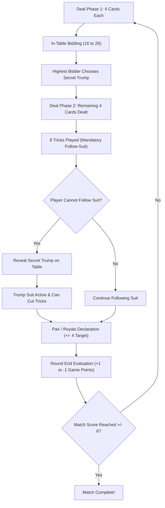

# ♠️ The 29 Game — Premium LAN Multiplayer Twenty-Nine Card Game ♥️

[](https://www.typescriptlang.org/)
[](https://reactjs.org/)
[](https://socket.io/)
[](https://expressjs.com/)
[](https://tailwindcss.com/)
[](https://vitest.dev/)
[](https://opensource.org/licenses/MIT)

> A modern, zero-install, real-time **LAN (Local Area Network)** multiplayer implementation of the traditional Indian **29 (Twenty-Nine)** trick-taking card game. Features authentic traditional Indian rules, original vector playing-card artwork extracted directly from an EPS collection (`poker-cards-icons-collection/OIUGSZ1.eps`), 100% in-table gameplay without disruptive popups, an authoritative 60-second turn timer with smart fallback play, interactive seat selection, and automatic CPU bot management.

---

## 🌟 Key Highlights

- **Original Playing-Card Vector Artwork**: Extracted directly from vector EPS artwork (`poker-cards-icons-collection/OIUGSZ1.eps`) at 1440 DPI with corner-seeded flood-fill background removal. High-resolution SVGs and PNGs render hand-illustrated Kings, Queens, Jacks, traditional suit symbols, and geometric card-backs with true vector sharpness on retina displays.
- **LAN-Only Architecture**: Zero reliance on public cloud services, external WebSockets, Supabase, or Firebase. Runs entirely on the host machine over local Wi-Fi / Ethernet (`0.0.0.0:3000`).
- **Interactive 4-Seat Selection**:
  - **Seat 1 (Bottom, Team A)**: Leader / Host
  - **Seat 2 (Left, Team B)**: Opponent Left
  - **Seat 3 (Top, Team A)**: Partner to Seat 1
  - **Seat 4 (Right, Team B)**: Opponent Right
  - Players can click any vacant seat in the lobby to switch positions or partner up.
- **Automatic CPU Player Management**: When the host clicks **Start Match**, any vacant seats are automatically filled by intelligent CPU bots (`CPU 1`, `CPU 2`, `Bot Partner`). Seamlessly supports:
  - 1 Human + 3 Bots (Instant Solo Play)
  - 2 Humans + 2 Bots (Friend Partnership vs AI)
  - 3 Humans + 1 Bot
  - 4 Humans (Full Local Multiplayer Table)
- **100% In-Table Gameplay (Strictly No Popups / Modals)**:
  - **In-Table Bidding**: Integrated directly onto the felt table with live bidding history chips, quick raise buttons, and pass controls.
  - **In-Table Secret Trump Selection**: Concurrently concealed suit selection embedded in the table dock.
  - **In-Table Trump Reveal**: Action button lights up on the table when unable to follow suit.
  - **In-Table Pair / Royals Declaration**: Crown button illuminates on the felt when holding K + Q of trump.
  - **In-Table Deal Summary**: Results and match point progression dock on the table between rounds.
- **Server-Authoritative 60-Second Timer & Smart Fallback**:
  - 60-second countdown per turn broadcast each second with low-time warning audio.
  - If a player runs out of time or disconnects, the server automatically executes a legal fallback move (Auto-Pass/Min-Bid in Bidding, Strongest Suit in Trump Selection, Optimal Legal Card in Trick Play).
- **Session Reconnection**: Players receive a unique session token in `localStorage`. If a player disconnects or refreshes, they instantly reclaim their seat and hand without disrupting the match.
- **Non-Blocking `?` Rules Drawer**: Slide-out drawer accessible at any moment without pausing the match or resetting the timer.
- **QR Code & Mobile LAN Access**: Host screen displays a generated QR code and LAN Wi-Fi URL (`http://<HOST_IP>:3000`) for mobile phones and tablets to join instantly.

---

## 🃏 Traditional 29 Card Game Rules

### 1. The 32-Card Deck

The game is played with a 32-card deck (8 cards per suit) extracted from the original artwork:

| Rank | Points | Hierarchy | Role in 29 |
| :---: | :---: | :---: | :--- |
| **Jack (J)** | **3** | Highest (#7) | Supreme trump / trick-taking card |
| **Nine (9)** | **2** | Second (#6) | High-scoring power card |
| **Ace (A)** | **1** | Third (#5) | High-card trick winner |
| **Ten (10)** | **1** | Fourth (#4) | Scoring counter |
| **King (K)** | **0** | Fifth (#3) | Pair / Royals component |
| **Queen (Q)** | **0** | Sixth (#2) | Pair / Royals component |
| **Eight (8)** | **0** | Seventh (#1) | Neutral follow-suit card |
| **Seven (7)** | **0** | Lowest (#0) | Lowest card in rank |

$$\text{Total Card Points} = 4 \times (3 + 2 + 1 + 1) = 28\text{ points}$$

Winning the 8th (last) trick awards **1 bonus point**, bringing total available points to **29 points**.

---

### 2. Table Layout & Partnership

```
                       Seat 3: Partner (Team A)
                              [ Top / North ]
                                    ▲
                                    |
Seat 2: Opponent (Team B) <───────(FELT)───────> Seat 4: Opponent (Team B)
      [ Left / West ]               |                  [ Right / East ]
                                    ▼
                         Seat 1: You (Team A)
                            [ Bottom / South ]
```

Partners sit opposite each other and combine card points.

---

### 3. Match Progression Flow



1. **Phase 1 Deal**: Each player is dealt 4 cards.
2. **Bidding**: Starts to the dealer's right. Minimum bid is 16. If all 4 players pass, the dealer is forced to bid 16.
3. **Secret Trump**: Highest bidder picks secret trump suit. Remains face-down.
4. **Phase 2 Deal**: Remaining 4 cards dealt (8 cards total per player).
5. **Trick Play**:
   - Mandatory follow-suit: if holding lead suit, player must follow.
   - If unable to follow suit, player can click **Reveal Trump** to uncover the concealed suit.
   - Once revealed, trump cards can cut and win non-trump tricks.
6. **Pair / Royals Bonus**:
   - Holding King + Queen of trump allows declaring Pair:
   - If declared by **Bidding Team**: Contract target is reduced by 4 (e.g. 17 becomes 13).
   - If declared by **Defending Team**: Contract target is increased by 4 (e.g. 17 becomes 21).
7. **Match Scoring**:
   - Fulfilling bid awards **+1 game point** (+2 for bids $\ge 21$).
   - Failing bid deducts **-1 game point** (-2 for bids $\ge 21$).
   - First team to reach **+6 points** wins; reaching **-6 points** loses.

---

## 🚀 How to Run the LAN Host Server

### Prerequisites
- [Node.js](https://nodejs.org/) v18+ (tested on Node v25).
- All players must be connected to the **same Wi-Fi or Local Area Network**.

### 1. Install Dependencies
```bash
npm install
```

### 2. Start the LAN Host Server
Run the host command:
```bash
npm run lan:host
```
*(Or alternatively: `node server.js`)*

The server automatically compiles the frontend build, detects the host's private Wi-Fi IPv4 address, binds to `0.0.0.0:3000`, and displays the host banner:

```
════════════════════════════════════════════════════════════════════
       ♠ ♥ ♦ ♣   THE 29 GAME — LAN MULTIPLAYER HOST   ♣ ♦ ♥ ♠
════════════════════════════════════════════════════════════════════
  Local Access:      http://localhost:3000
  LAN / Wi-Fi URL:   http://192.168.1.2:3000
────────────────────────────────────────────────────────────────────
  HOW TO CONNECT PLAYERS ON YOUR LOCAL NETWORK:
  1. Ensure all laptops, phones, or tablets are on the same Wi-Fi.
  2. Open http://192.168.1.2:3000 on any browser.
  3. Join with your Room Code or scan the QR Code on screen.
════════════════════════════════════════════════════════════════════
```

### 3. Connect Other Players
- Open `http://<HOST_IP>:3000` (e.g. `http://192.168.1.2:3000`) on any computer, tablet, or phone on the same Wi-Fi.
- Click **Join LAN Game**, enter your name and the 6-character room code, and pick your preferred seat.
- Or scan the **QR Code** directly from the host's lobby screen!

### 4. Running in Development Mode
To develop with Vite hot-module replacement:
```bash
npm run dev
```

---

## 🧪 Testing and Verification

Run the full suite of unit and integration tests covering card manifest point values, trick evaluation, bidding rules, LAN room management, and timeout fallbacks:

```bash
npm test
```

```
✓ src/engine/engine.test.ts (16 tests)
✓ src/engine/lanRoom.test.ts (6 tests)
Test Files  2 passed (2)
     Tests  22 passed (22)
```

To run a production build verification:
```bash
npm run build
```

---

## 📁 Project Architecture

```
.
├── poker-cards-icons-collection/  # Original EPS playing card vector artwork collection
│   └── OIUGSZ1.eps               # Authoritative vector sheet for all 32 cards + card back
├── public/assets/cards/           # Converted pristine SVG & PNG 1440 DPI card assets
├── scripts/
│   └── extract_cards.py          # Ghostscript 1440 DPI vector extraction pipeline
├── server/
│   ├── index.ts                  # Express + Socket.IO LAN server
│   ├── lanUtils.ts               # Local network IPv4 detection & terminal banner
│   └── roomManager.ts            # Authoritative room state, 60s timer, & bot auto-play
├── server.js                     # Root executable server launcher (node server.js)
├── src/
│   ├── assets/
│   │   └── cardManifest.ts       # 32-card manifest, points, order, and asset paths
│   ├── common/
│   │   └── SoundManager.ts       # Procedural Web Audio API sound synthesizer
│   ├── components/
│   │   ├── card/
│   │   │   ├── CardPreviewGallery.tsx  # EPS card asset inspection gallery
│   │   │   └── PlayingCard.tsx         # Responsive playing card component
│   │   ├── lobby/
│   │   │   ├── CreateRoomModal.tsx     # LAN room creator with rule presets
│   │   │   ├── HomeView.tsx            # Main landing view with LAN options
│   │   │   ├── JoinRoomModal.tsx       # Join by code / host IP / seat selector
│   │   │   └── LobbyView.tsx           # 4-seat interactive lobby with QR code
│   │   └── table/
│   │       ├── GameTable.tsx           # Central 29 table felt
│   │       ├── InTableBidding.tsx      # 100% in-table bidding dock (no popups)
│   │       ├── InTableRoundSummary.tsx # In-table round points breakdown
│   │       ├── InTableTrumpSelector.tsx# In-table secret trump selector
│   │       ├── OpponentSeat.tsx        # Opponent seats with card count & turn rings
│   │       ├── PlayerHand.tsx          # Interactive hand with legal card lift
│   │       ├── RulesDrawer.tsx         # Non-blocking slide-out rules reference
│   │       ├── Scoreboard.tsx          # Team A vs Team B scoreboard
│   │       └── TrickArea.tsx           # Center 4-card trick arena
│   ├── engine/
│   │   ├── bidding.ts            # Bidding logic, legal bid options, forced dealer
│   │   ├── bot.ts                # Autonomous CPU player decision engine
│   │   ├── deck.ts               # 32-card deck shuffling and 2-phase dealing
│   │   ├── gameManager.ts        # Authoritative state machine & transitions
│   │   ├── scoring.ts            # Trick evaluation, Pair/Royals, round points
│   │   ├── tricks.ts             # Legal card filtering & follow-suit validation
│   │   └── types.ts              # Core TypeScript interfaces & rules types
│   ├── services/
│   │   └── lanClient.ts          # Client Socket.IO service & session reconnection
│   ├── App.tsx                   # Top-level state and view router
│   └── main.tsx                  # React DOM root entry
├── package.json
└── tsconfig.json
```

---

## 📄 License

This project is licensed under the [MIT License](LICENSE).
