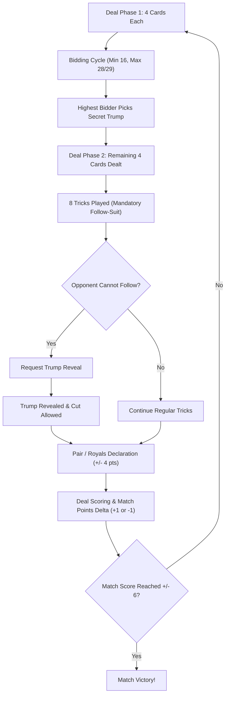

# ♠️ Traditional Indian 29 (Twenty-Nine) Online Multiplayer Card Game ♥️

[](https://github.com/actions)
[](https://www.typescriptlang.org/)
[](https://reactjs.org/)
[](https://vitejs.dev/)
[](https://tailwindcss.com/)
[](https://vitest.dev/)
[](https://opensource.org/licenses/MIT)

> A modern, zero-install, real-time multiplayer implementation of the classic South Asian **29 (Twenty-Nine)** trick-taking card game. Features authentic traditional Indian rules, vector playing-card artwork extracted directly from an EPS collection, private room invitations, partner team selection, concealed trump mechanics, heuristic AI bots, and automated deployment to GitHub Pages.

---

## 🌟 Key Highlights

- **Authentic Card Artwork**: Extracted directly from vector EPS artwork (`poker-cards-icons-collection/OIUGSZ1.eps`), retaining hand-illustrated Kings, Queens, Jacks, traditional suit symbols, and geometric card-backs with true alpha transparency. Available in both scalable SVG and 600 DPI crisp PNG.
- **True Partnership Multiplayer**: Form a 2-player team with your friend (sitting opposite each other: P0 & P2 on Team A) against two human opponents or AI computer bots (Team B).
- **Zero-Leak Security**: Private hands are accessible only by the respective player. The concealed trump suit remains strictly hidden from opponents until formally revealed.
- **Robust Rules Engine**: Implements the full Indian 29 ruleset:
  - 32-card deck (J, 9, A, 10, K, Q, 8, 7).
  - Point count: Jack (3), Nine (2), Ace (1), Ten (1); total 28 + optional 1 last-trick bonus = 29.
  - Two-phase deal (4 cards -> Bidding -> Concealed Trump -> 4 cards -> Trick play).
  - Mandatory follow-suit with strategic trump cuts.
  - Pair / Royals rule (King + Queen of trump adjusts contract target by ±4).
  - Cumulative match scoring (first team to +6 wins, -6 loses).
- **Browser-Native & Responsive**: Playable on Desktop, MacBook, Windows, iPad, iPhone Safari, and Android Chrome.
- **Autonomous Bots**: Intelligent AI players capable of hand evaluation, strategic bidding, trump picking, suit-following, and cutting.
- **Instant Deployment**: Built for seamless hosting on GitHub Pages via automated GitHub Actions.

---

## 🃏 29 (Twenty-Nine) Game Rules Overview

### 1. The 32-Card Deck
The game uses 8 cards per suit across 4 suits (Diamonds, Spades, Hearts, Clubs).

| Rank | Points | Rank Hierarchy | Description |
| :---: | :---: | :---: | :--- |
| **Jack (J)** | **3** | Highest (#7) | The most powerful trump / suit card |
| **Nine (9)** | **2** | Second (#6) | High-scoring power card |
| **Ace (A)** | **1** | Third (#5) | High-card trick taker |
| **Ten (10)** | **1** | Fourth (#4) | Crucial scoring counter |
| **King (K)** | **0** | Fifth (#3) | Pair / Royals component |
| **Queen (Q)** | **0** | Sixth (#2) | Pair / Royals component |
| **Eight (8)** | **0** | Seventh (#1) | Neutral follow-suit card |
| **Seven (7)** | **0** | Lowest (#0) | Lowest card in rank |

> **Total card points in deck**: $4 \times (3 + 2 + 1 + 1) = 28\text{ points}$.  
> Winning the 8th (last) trick awards **1 bonus point**, bringing the grand total to **29 points**.

---

### 2. Match Structure & Seating
- **4 Players** arranged around a table:
  - **South (Player 0)** & **North (Player 2)**: Team A (Partners)
  - **West (Player 1)** & **East (Player 3)**: Team B (Partners)
- Partners sit directly opposite each other and combine card points.

```
                  Partner (P2 - Team A)
                         [ North ]
                             ▲
                             |
   Opponent 1 (P1 - Team B) <+> Opponent 2 (P3 - Team B)
          [ West ]           |          [ East ]
                             ▼
                    You (P0 - Team A)
                         [ South ]
```

---

### 3. Game Phases



1. **Phase 1 Deal**: Each player is dealt 4 cards.
2. **Bidding**: Starts to the left of the dealer. Minimum bid is 16. Highest bidder sets the contract. If all pass, dealer is forced to bid 16.
3. **Concealed Trump**: Bidder privately chooses the trump suit. It is placed face-down and kept secret.
4. **Phase 2 Deal**: Remaining 4 cards dealt to each player (8 cards total in hand).
5. **Trick Play**:
   - Player to dealer's left leads the first trick.
   - **Mandatory Follow-Suit**: If a player holds the suit led, they must play it.
   - If a player cannot follow suit, they can ask to **Reveal Trump**. Once revealed, they can cut with trump or discard.
6. **Pair / Royals**: A player holding both the **King and Queen of the trump suit** can declare Pair after winning a trick.
   - Bidding team: reduces target by 4.
   - Defending team: increases target by 4.
7. **Scoring**:
   - Contract fulfilled: Bidding team gains **+1 Game Point** (+2 for bids $\ge 21$).
   - Contract failed: Bidding team loses **-1 Game Point** (-2 for bids $\ge 21$).
   - First team to **+6** wins the match; reaching **-6** loses.

---

## 🎨 Asset Extraction & Mapping

The playing card artwork was extracted directly from `poker-cards-icons-collection/OIUGSZ1.eps`:
- Total 54 cards in the source vector matrix (6 rows $\times$ 9 columns).
- Vector background converted to true alpha transparency.
- The 32 cards required by 29 + geometric card back are mapped in `src/assets/cardManifest.ts`:

| Rank | Diamonds | Spades | Hearts | Clubs | Points |
| :--- | :--- | :--- | :--- | :--- | :---: |
| **Jack (J)** | Col 0, Row 2 | Col 1, Row 2 | Col 2, Row 2 | Col 3, Row 2 | 3 |
| **Nine (9)** | Col 0, Row 4 | Col 1, Row 4 | Col 2, Row 4 | Col 3, Row 4 | 2 |
| **Ace (A)** | Col 4, Row 3 | Col 4, Row 2 | Col 4, Row 1 | Col 4, Row 0 | 1 |
| **Ten (10)** | Col 0, Row 3 | Col 1, Row 3 | Col 2, Row 3 | Col 3, Row 3 | 1 |
| **King (K)** | Col 0, Row 0 | Col 1, Row 0 | Col 2, Row 0 | Col 3, Row 0 | 0 |
| **Queen (Q)** | Col 0, Row 1 | Col 1, Row 1 | Col 2, Row 1 | Col 3, Row 1 | 0 |
| **Eight (8)** | Col 0, Row 5 | Col 1, Row 5 | Col 2, Row 5 | Col 3, Row 5 | 0 |
| **Seven (7)** | Col 5, Row 0 | Col 6, Row 0 | Col 7, Row 0 | Col 8, Row 0 | 0 |
| **Card Back** | — | — | — | Col 4, Row 5 | — |

Explore the live card inspector by clicking **"View 32 Card Assets Gallery"** on the home screen.

---

## 🚀 Quick Start & Local Development

### Prerequisites
- Node.js 18+ or 20+
- npm 9+

### Installation

```bash
# 1. Clone repository
git clone https://github.com/<your-username>/twenty-nine-card-game.git
cd twenty-nine-card-game

# 2. Install dependencies
npm install

# 3. Start local development server
npm run dev
```

Visit `http://localhost:3000` in your browser.

### Running Engine Tests

```bash
npm test
```

### Production Build

```bash
npm run build
```

---

## 🌐 Online Multiplayer Setup (Supabase)

The game includes a self-contained local broadcast and peer engine that allows offline play and multi-tab simulation immediately without any setup.

To enable cross-device internet multiplayer across different networks:

1. Create a free project at [supabase.com](https://supabase.com).
2. In the Supabase SQL Editor, run the migration script located in:
   ```bash
   supabase/schema.sql
   ```
3. Copy your Supabase Project URL and Anon Public Key from **Project Settings -> API**.
4. Create a `.env` file from `.env.example`:
   ```bash
   cp .env.example .env
   ```
   Add your keys:
   ```env
   VITE_SUPABASE_URL=https://your-project.supabase.co
   VITE_SUPABASE_ANON_KEY=your-anon-key-here
   ```
5. Rebuild or restart `npm run dev`. Real-time room synchronization is now globally active!

---

## 🚢 Deploying to GitHub Pages

Automated deployment is pre-configured via GitHub Actions (`.github/workflows/deploy.yml`):

1. Push your repository to GitHub:
   ```bash
   git add .
   git commit -m "feat: complete Indian 29 multiplayer game"
   git push origin main
   ```
2. In your GitHub repository, navigate to **Settings -> Pages**.
3. Under **Build and deployment -> Source**, select **GitHub Actions**.
4. The deployment workflow will automatically run, test, build, and deploy the game to:
   ```
   https://<your-username>.github.io/<your-repo-name>/
   ```

---

## 🤝 Contributing

Contributions from the open-source community are warmly welcomed!

1. Fork the Project.
2. Create your Feature Branch (`git checkout -b feature/AmazingFeature`).
3. Commit your Changes (`git commit -m 'Add some AmazingFeature'`).
4. Push to the Branch (`git push origin feature/AmazingFeature`).
5. Open a Pull Request.

---

## 📜 License

Distributed under the MIT License. See `LICENSE` for more information.
