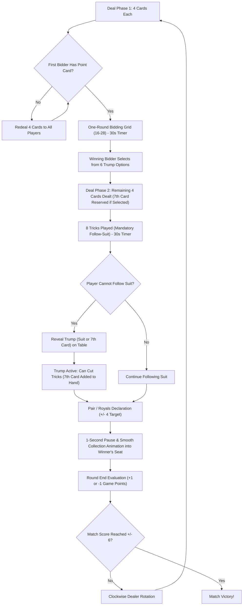

# ♠️ The 29 Game — Premium LAN Multiplayer Twenty-Nine Card Game ♥️

[](https://www.typescriptlang.org/)
[](https://reactjs.org/)
[](https://socket.io/)
[](https://expressjs.com/)
[](https://tailwindcss.com/)
[](https://vitest.dev/)
[](https://opensource.org/licenses/MIT)

> A modern, zero-install, real-time **LAN (Local Area Network)** multiplayer implementation of the traditional Indian **29 (Twenty-Nine)** trick-taking card game. Features authentic traditional Indian rules, edge-to-edge full-screen table felt (`table.jpg`), original vector playing-card artwork extracted directly from an EPS collection (`poker-cards-icons-collection/OIUGSZ1.eps`), larger cards with gentle horizontal overlap, bright minimalistic UI, animal emoji avatars, individual trick-point counters, clean 3-element direct-click bidding, uniform 30-second turns, minimal scoreboard (+6 to win), 1-second trick collection animation, original sound effects (`sound-effects/`), physical drag-and-drop card playing, single-round auction with forced dealer opening, six trump options (including Joker / No Trump and 7th Card), first-bidder point-card eligibility redeals, and authentic Indian AI players.

---

## 🌟 Key Highlights

- **Full-Screen Edge-to-Edge Table (`table.jpg`)**:
  - The game table occupies **100% of the browser viewport width and height** without outer containers, black bars, or constrained aspect boxes.
  - The authentic wooden-rimmed green felt (`table.jpg`) acts as the full-screen canvas with edge-to-edge rendering.
  - All four player positions (Seat 1 Bottom, Seat 2 Left, Seat 3 Top, Seat 4 Right) and the central trick area adapt responsively to any screen size.
- **Larger Horizontally Spread Playing Cards**:
  - Playing cards are rendered significantly larger across all desktop and mobile viewports (`w-22 h-[7.7rem] sm:w-26 md:w-30 lg:w-32`) with crisp vector illustrations, high contrast, and drop-shadows.
  - All 8 cards spread out horizontally across the bottom with gentle, reduced overlap.
  - Cards lift upward ($-32\text{px}$) and scale up ($1.12\times$) on hover without clipping.
  - Physical drag-and-drop targeting a generous central invisible table hitbox (or direct click to play).
- **Uniform 30-Second Turn Timers**:
  - Standardized **30-second timers** across all player turns: Bidding, Trump Selection, and Card Play.
  - Synchronized via epoch `turnDeadline` timestamps with server-authoritative auto-pass or auto-play fallback.
  - Displays a live countdown badge (`00:30` down to `00:00`) on the active player's seat with urgent pulse during the final 5 seconds.
- **Bright, Light Minimalistic Aesthetic**:
  - Replaced dark mode panels with bright, light, modern UI elements (`bg-white/95`, light borders, and subtle shadows).
  - High-contrast typography and clean lines keep the authentic table artwork as the central focus while cleaning up surrounding controls.
- **Distinct Animal Emoji Avatars & Individual Trick-Point Counters**:
  - Each player is assigned a unique animal emoji avatar (🦊, 🐼, 🐯, 🐸, 🦁, 🐻, 🐵, 🐺, 🐨, 🦉, 🐧, 🐱, 🐰, 🦄, 🦖, 🦋).
  - Individual point counters display live trick points won (e.g. `· 7 pts`) next to each player.
  - Removed "Left Opponent" and "Right Opponent" text labels and card-back rows for a clean, uncluttered presentation.
- **Clean 3-Element In-Table Bidding Panel**:
  - **Element 1 (Header)**: Active bidder's animal avatar, name, current bid status (`Target: 18` or `Opening: 16 min`), and 30-second timer.
  - **Element 2 (Legal Bid Grid)**: Clean grid of clickable bid buttons starting from the next legal bid value up to 28. Single tap immediately places the bid (no second confirmation or tedious steppers).
  - **Element 3 (Action)**: Single prominent `PASS` button (or locked indicator when dealer is forced to open).
- **Minimal Scoreboard (+6 Match Win Condition)**:
  - Clean light pill at the top displaying match points for Team A (Seats 1 & 3) and Team B (Seats 2 & 4), e.g. `Team A: +3 | Team B: +2`.
  - Once bidding completes, permanent target and bidding team info is displayed: `Target: 20 · Bidding: Team A`.
  - First team to reach **+6 points** wins the match; reaching **-6 points** loses.
  - No trick counter watermarks or redundant clutter.
- **1-Second Trick Collection Animation**:
  - When all 4 cards of a trick are played, cards pause in place for **exactly 1 second** so players can clearly see who played what and who won.
  - Cards then smoothly glide (`transform: translate3d(...) scale(0.15) opacity(0)`) directly into the winning player's seat (Bottom, Left, Top, or Right), accompanied by `card-shove-1.ogg`.
  - Removed trick counters and player name tags under trick cards.
- **Original Playing-Card Vector Artwork**: Extracted directly from vector EPS artwork (`poker-cards-icons-collection/OIUGSZ1.eps`) at 1440 DPI with corner-seeded flood-fill background removal. High-resolution SVGs and PNGs render hand-illustrated Kings, Queens, Jacks, traditional suit symbols, and geometric card-backs with true vector sharpness on retina displays.
- **Authentic Sound Effects (`sound-effects/`)**:
  - `card-shuffle.ogg`: Played at the start of a new deal.
  - `cards-pack-take-out-1.ogg`: Played when cards are dealt to players.
  - `card-slide-1.ogg`: Played during card dragging, hovering, and hand interaction.
  - `card-place-1.ogg`: Played when a card is dropped/played onto the table.
  - `card-shove-1.ogg`: Played when collecting and clearing a completed trick.
  - Integrated with header volume slider (0–100%), one-click mute toggle, and `localStorage` persistence.
- **Six Trump Selection Options**:
  1. **Hearts (♥️)**: Secret suit concealed face-down.
  2. **Spades (♠️)**: Secret suit concealed face-down.
  3. **Clubs (♣️)**: Secret suit concealed face-down.
  4. **Diamonds (♦️)**: Secret suit concealed face-down.
  5. **Joker / No Trump (`NO_TRUMP`)**: No trump suit. Highest card of the led suit wins each trick; off-suit cards cannot cut; Royal Pairs cannot be declared.
  6. **7th Card Trump (`SEVENTH_CARD`)**: The bidder's 7th card (dealt during the 2nd deal of 4 cards) is reserved face-down on the table as the secret trump card. When trump is revealed during trick play, the card flips over, its suit becomes the trump suit, and it is added into the winning bidder's playable hand.
- **First-Bidder Point-Card Eligibility**:
  - The first bidder (player to the dealer's left) must hold at least one point-valued card (Jack=3, Nine=2, Ace=1, or Ten=1).
  - If the first bidder holds 0 point cards, all 16 dealt cards are automatically returned, reshuffled, and redealt until an eligible hand is formed, preserving the dealer and first bidder.
- **Realistic Indian AI Players**:
  - CPU players draw authentic Indian human names (e.g. *Aarav, Mira, Kabir, Anaya, Rohan, Tara, Ishaan, Aditi, Vihaan, Arjun*, etc.).
  - No generic "CPU", "Bot", or "Computer" tags in player names.
- **LAN-Only Architecture**: Zero reliance on public cloud services, external WebSockets, Supabase, or Firebase. Runs entirely on the host machine over local Wi-Fi / Ethernet (`0.0.0.0:3000`).
- **Session Reconnection**: Players receive a unique session token in `localStorage`. If a player disconnects or refreshes, they instantly reclaim their seat and hand without disrupting the match.
- **Non-Blocking `?` Rules Drawer**: Slide-out drawer accessible at any moment without pausing the match or resetting the timer.
- **QR Code & Mobile LAN Access**: Host screen displays a generated QR code and LAN Wi-Fi URL (`http://<HOST_IP>:3000`) for mobile phones and tablets to join instantly.

---

## 🃏 Traditional 29 Card Game Rules

### 1. The 32-Card Deck

The game is played with a 32-card deck (8 cards per suit) extracted from the original artwork:

| Rank | Points | Hierarchy | Role in 29 |
| :---: | :---: | :---: | :--- |
| **Jack (J)** | **3** | Highest (#7) | Supreme trump / trick-taking card |
| **Nine (9)** | **2** | Second (#6) | High-scoring power card |
| **Ace (A)** | **1** | Third (#5) | High-card trick winner |
| **Ten (10)** | **1** | Fourth (#4) | Scoring counter |
| **King (K)** | **0** | Fifth (#3) | Pair / Royals component |
| **Queen (Q)** | **0** | Sixth (#2) | Pair / Royals component |
| **Eight (8)** | **0** | Seventh (#1) | Neutral follow-suit card |
| **Seven (7)** | **0** | Lowest (#0) | Lowest card in rank |

$$\text{Total Card Points} = 4 \times (3 + 2 + 1 + 1) = 28\text{ points}$$

Winning the 8th (last) trick awards **1 bonus point**, bringing total available points to **29 points**.

---

### 2. Table Layout & Partnership

```
                       Seat 3: Partner (Team A)
                              [ Top / North ]
                                    ▲
                                    |
Seat 2: Opponent (Team B) <───────(FELT)───────> Seat 4: Opponent (Team B)
      [ Left / West ]               |                  [ Right / East ]
                                    ▼
                         Seat 1: You (Team A)
                            [ Bottom / South ]
```

Partners sit opposite each other and combine card points:
- **Team A**: Seat 1 (South) & Seat 3 (North)
- **Team B**: Seat 2 (West) & Seat 4 (East)

---

### 3. Match Progression Flow



1. **Initial Deal & Eligibility**: Each player is dealt 4 cards. The dealer is randomly chosen in Round 1 and rotates clockwise in subsequent rounds. The first bidder (player to dealer's left) must hold $\ge 1$ point card (J, 9, A, 10).
2. **Single-Round Auction (30s Turn Timer)**: Exactly 4 turns in clockwise order ($D+1 \to D+2 \to D+3 \to D$). Opening bid is minimum 16. Bidders select directly from the legal bid grid (16–28) with a single tap, or click PASS. If all 3 players pass, the dealer is forced to bid 16.
3. **Six Trump Options**: Winning bidder chooses among 4 suits, Joker / No Trump, or 7th Card.
4. **Phase 2 Deal**: Remaining 4 cards dealt. In 7th Card mode, bidder's 7th card is reserved face-down on the table until revealed.
5. **Trick Play (30s Turn Timer & Drag-to-Play)**:
   - Players drag cards from hand onto the central green felt trick area (or click to play).
   - Mandatory follow-suit: if holding lead suit, player must follow.
   - If unable to follow suit, player can click **Ask for Trump** to uncover the concealed suit or 7th card.
   - Once revealed, trump cards can cut and win non-trump tricks. In 7th Card mode, the 7th card returns to the bidder's hand.
   - In No Trump mode, the highest card of the lead suit always wins; off-suits cannot cut.
   - When 4 cards are played, cards pause for 1 second and smoothly glide to the trick winner's seat.
6. **Pair / Royals Bonus**:
   - Holding King + Queen of trump allows declaring Pair:
   - If declared by **Bidding Team**: Contract target is reduced by 4 (e.g. 17 becomes 13).
   - If declared by **Defending Team**: Contract target is increased by 4 (e.g. 17 becomes 21).
7. **Match Scoring**:
   - Fulfilling bid awards **+1 game point** (+2 for bids $\ge 21$).
   - Failing bid deducts **-1 game point** (-2 for bids $\ge 21$).
   - Minimal scoreboard tracks Team A and Team B match points. First team to reach **+6 points** wins; reaching **-6 points** loses.

---

## 🚀 How to Run the LAN Host Server

### Prerequisites
- [Node.js](https://nodejs.org/) v18+ (tested on Node v25).
- All players must be connected to the **same Wi-Fi or Local Area Network**.

### 1. Install Dependencies
```bash
npm install
```

### 2. Start the LAN Host Server
Run the host command:
```bash
npm run lan:host
```
*(Or alternatively: `node server.js`)*

The server automatically compiles the frontend build, detects the host's private Wi-Fi IPv4 address, binds to `0.0.0.0:3000`, and displays the host banner:

```
════════════════════════════════════════════════════════════════════
       ♠ ♥ ♦ ♣   THE 29 GAME — LAN MULTIPLAYER HOST   ♣ ♦ ♥ ♠
════════════════════════════════════════════════════════════════════
  Local Access:      http://localhost:3000
  LAN / Wi-Fi URL:   http://192.168.1.2:3000
────────────────────────────────────────────────────────────────────
  HOW TO CONNECT PLAYERS ON YOUR LOCAL NETWORK:
  1. Ensure all laptops, phones, or tablets are on the same Wi-Fi.
  2. Open http://192.168.1.2:3000 on any browser.
  3. Join with your Room Code or scan the QR Code on screen.
════════════════════════════════════════════════════════════════════
```

### 3. Connect Other Players
- Open `http://<HOST_IP>:3000` (e.g. `http://192.168.1.2:3000`) on any computer, tablet, or phone on the same Wi-Fi.
- Click **Join LAN Game**, enter your name and the 6-character room code, and pick your preferred seat.
- Or scan the **QR Code** directly from the host's lobby screen!

### 4. Running in Development Mode
To develop with Vite hot-module replacement:
```bash
npm run dev
```

---

## 🧪 Testing and Verification

Run the full suite of unit and integration tests covering card manifest point values, trick evaluation, bidding rules, 6 trump options, 7th card mechanics, dealer rotation, and LAN room management:

```bash
npm test
```

```
✓ src/engine/engine.test.ts (28 tests)
✓ src/engine/lanRoom.test.ts (8 tests)
Test Files  2 passed (2)
     Tests  36 passed (36)
```

To run a production build verification:
```bash
npm run build
```

---

## 📁 Project Architecture

```
.
├── game_logo.png                  # Official 29 game logo
├── table.jpg                      # Full-screen edge-to-edge oval green table felt background
├── sound-effects/                 # Original game sound effects
│   ├── card-place-1.ogg          # Card played onto table
│   ├── card-shove-1.ogg          # Trick collected & shoved
│   ├── card-shuffle.ogg          # Deck shuffle at deal start
│   ├── card-slide-1.ogg          # Card hover/drag slide
│   └── cards-pack-take-out-1.ogg # Dealing cards
├── poker-cards-icons-collection/  # Original EPS playing card vector artwork collection
│   └── OIUGSZ1.eps               # Authoritative vector sheet for all 32 cards + card back
├── public/
│   ├── assets/
│   │   ├── cards/                # Converted pristine SVG & PNG 1440 DPI card assets
│   │   ├── sounds/               # Optimized OGG audio files for web audio playback
│   │   ├── game_logo.png         # Public logo asset
│   │   └── table.jpg             # Public table felt asset
├── scripts/
│   └── extract_cards.py          # Ghostscript 1440 DPI vector extraction pipeline
├── server/
│   ├── index.ts                  # Express + Socket.IO LAN server
│   ├── lanUtils.ts               # Local network IPv4 detection & terminal banner
│   └── roomManager.ts            # Authoritative room state, 30s timers, avatar pool, & bot auto-play
├── server.js                     # Root executable server launcher (node server.js)
├── src/
│   ├── assets/
│   │   └── cardManifest.ts       # 32-card manifest, points, order, and asset paths
│   ├── common/
│   │   └── SoundManager.ts       # Web Audio API buffer engine with volume/mute controls
│   ├── components/
│   │   ├── card/
│   │   │   ├── CardPreviewGallery.tsx  # EPS card asset inspection gallery
│   │   │   └── PlayingCard.tsx         # Large, 100% opaque vector card component
│   │   ├── lobby/
│   │   │   ├── CreateRoomModal.tsx     # LAN room creator with rule presets
│   │   │   ├── HomeView.tsx            # Main landing view with game_logo.png
│   │   │   ├── HowToPlayModal.tsx      # Comprehensive rules dialog
│   │   │   ├── JoinRoomModal.tsx       # Join by code / host IP / seat selector
│   │   │   └── LobbyView.tsx           # 4-seat interactive lobby with QR code & logo
│   │   └── table/
│   │       ├── GameTable.tsx           # Full-screen edge-to-edge 29 table with table.jpg
│   │       ├── InTableBidding.tsx      # Clean 3-element direct-click bid grid with 30s timer
│   │       ├── InTableRoundSummary.tsx # Bright in-table round points breakdown
│   │       ├── InTableTrumpSelector.tsx# In-table 6-option secret trump selector with 30s timer
│   │       ├── OpponentSeat.tsx        # Animal emoji avatar, individual points, 30s countdown
│   │       ├── PlayerHand.tsx          # Horizontally spread hand with gentle overlap & hover lift
│   │       ├── RulesDrawer.tsx         # Non-blocking slide-out rules reference
│   │       ├── Scoreboard.tsx          # Minimal Team A vs Team B match scoreboard (+6 to win)
│   │       ├── TrickArea.tsx           # 1-second pause & smooth collection animation to winner
│   │       └── TrumpIndicator.tsx      # Bright in-table trump & 7th card indicator
│   ├── engine/
│   │   ├── bidding.ts            # Bidding logic, legal bid options, forced dealer
│   │   ├── biddingOrder.ts       # Seating, clockwise rotation, point-card eligibility
│   │   ├── bot.ts                # Autonomous CPU player decision engine
│   │   ├── botNames.ts           # Authentic Indian CPU player names pool
│   │   ├── deck.ts               # 32-card Fisher-Yates generator, 2-phase dealing (4+4)
│   │   ├── gameManager.ts        # Authoritative state machine & transitions
│   │   ├── scoring.ts            # Card points accumulator (28+1=29), Royals Pair (+/-4)
│   │   ├── tricks.ts             # Legal card filtering & follow-suit validation
│   │   └── types.ts              # Core TypeScript interfaces & rules types
│   ├── services/
│   │   └── lanClient.ts          # Client Socket.IO service & session reconnection
│   ├── App.tsx                   # Top-level state and view router
│   └── main.tsx                  # React DOM root entry
├── package.json
└── tsconfig.json
```

---

## 📄 License

This project is licensed under the [MIT License](LICENSE).
