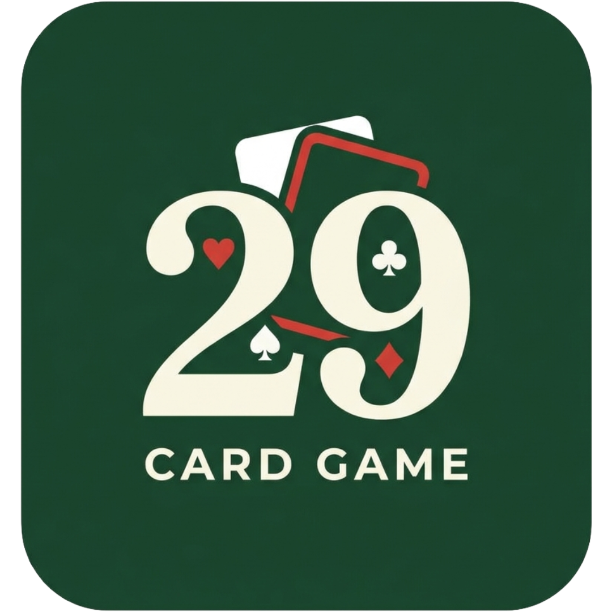
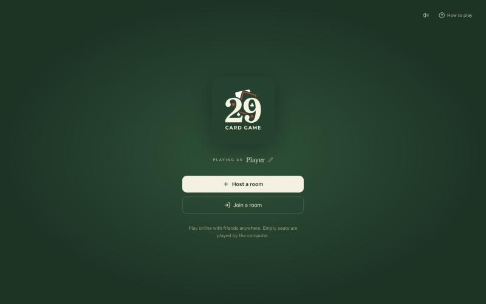
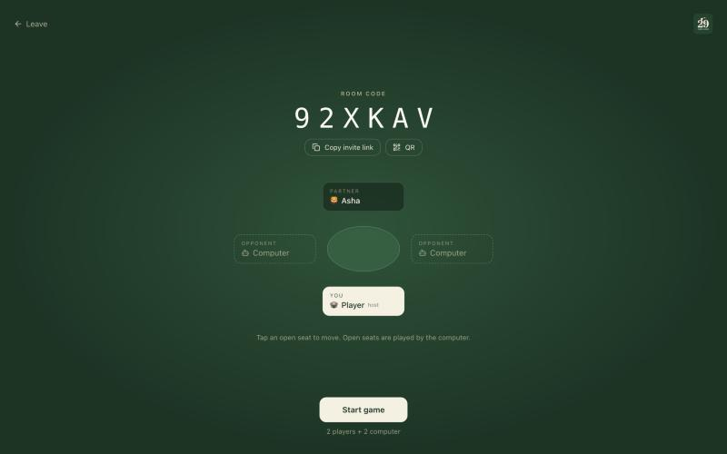
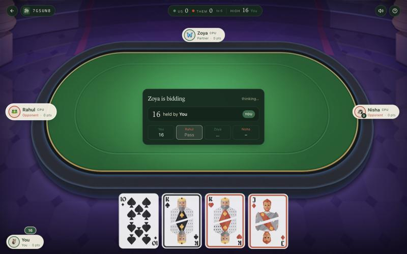
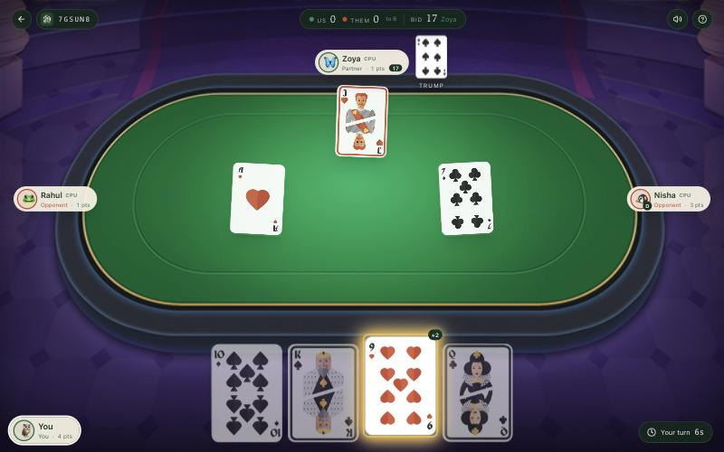
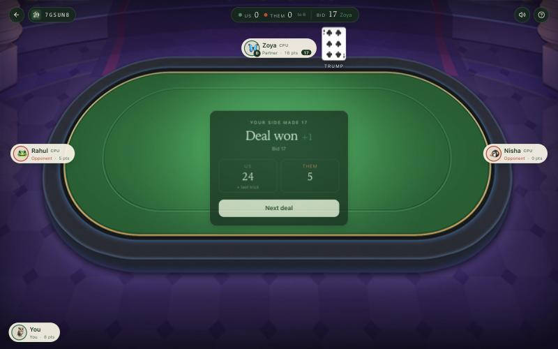

<p align="center">
  
</p>

<h1 align="center">The 29 Game</h1>

<p align="center">
  The traditional Indian trick-taking card game <b>Twenty-Nine</b>, played online with friends.<br/>
  Empty seats are filled by computer players, so you can start with 1, 2, 3 or 4 people.
</p>

<p align="center">
  <a href="https://k-692.github.io/The-29-Game/"><b>▶ Play now — https://k-692.github.io/The-29-Game/</b></a>
</p>

<p align="center">
  
  
  
  
  
</p>

---

## Screenshots

| Home | Lobby |
| --- | --- |
|  |  |

| Bidding — who holds the high bid, partner or opponent | Trick play — trump revealed, only legal cards lit |
| --- | --- |
|  |  |

| Round summary |
| --- |
|  |

---

## How to play online

1. Open **https://k-692.github.io/The-29-Game/** and choose **Host a room**.
2. Share the 6-letter room code, the **Copy invite link** button or the QR code. Friends can be anywhere — no shared Wi-Fi needed.
3. Friends choose **Join a room** (or just open the invite link). Tap any open seat to move; partners sit opposite each other.
4. The host presses **Start game**. Every empty seat is played by a computer player.
5. A friend who arrives late can join with the code and **take over a computer player's seat mid-game**. If someone leaves, a computer player takes their seat so their partner keeps playing.

Refreshing the page puts you straight back in your seat.

## Features

- **Full 29 rules** — 32-card deck, J > 9 > A > 10 > K > Q > 8 > 7, 28 card points + 1 for the last trick.
- **Bidding (16–29)** with a forced dealer opening; seat bubbles and the bidding panel always show who holds the high bid and whether they're your partner or an opponent.
- **Six trump choices** — any suit, **Joker** (no trump) or the **7th card**.
- **Trump always wins**: a trump beats every other card and the highest trump wins an over-trump. Playing a trump when you can't follow suit reveals it.
- **Double (2×) & Re-double (4×)** with 10-second team decision windows.
- **King & Queen pair** — changes the target by ±4 when trump is revealed (bid 19+).
- **Computer players** for any empty seat; they only use what their seat could know.
- **Turn timers** (15 s) with a safe automatic move when time runs out; the game pauses if every human disconnects.
- **Always-visible scoreboard**, animated dealing, card play, trick collection and a trump-reveal effect.
- **Private hands** — each device only ever receives its own cards.

## How it works

```
Browser (GitHub Pages, React + Vite)
   │  POST actions                       ▲  Realtime broadcast
   ▼                                     │   room-<CODE>     public table & lobby
Supabase Edge Function `game`  ──────────┘   seat-<secret>   your hand only
   │  load → apply → save (optimistic locking)
   ▼
Postgres `game_rooms` (RLS on, no client access — hands and seat tokens stay server-side)
```

- The server is **stateless**. The game engine (`src/engine/`) and the room state machine (`src/engine/room/roomMachine.ts`) are pure TypeScript functions of `(room, now)`, shared by the browser and the Edge Function.
- There are no server timers. Each update tells clients when the next automatic step is due (computer move, timeout, trick collection, next deal). The connected players' browsers ask the server to **advance** at that time — the lowest-seated human first, the others as backups. The server only does what is actually due, so duplicate requests are harmless.
- Updates are pushed with **Supabase Realtime broadcast**: one public channel per room, plus a private channel per seat whose name is a secret only that player knows.

## Run it locally

```bash
npm install
```

```bash
npm run dev
```

Opens on http://localhost:5173 and talks to the hosted Supabase backend. To use your own Supabase project, set `VITE_SUPABASE_URL` and `VITE_SUPABASE_KEY` (the publishable key) in `.env.local`.

```bash
npm test
```

Runs the 78 unit tests (rules engine, scoring, Double/Re-double, King-Queen pair, trump rule and the online room state machine).

## Deploying

**Frontend** — pushing to `main` runs `.github/workflows/deploy.yml`, which tests, builds and publishes `dist/` to the `gh-pages` branch. In the repository's **Settings → Pages**, the source must be *Deploy from a branch → `gh-pages` / `(root)`*.

**Backend** (Supabase):

1. Apply `supabase/migrations/20261117000000_create_game_rooms.sql`.
2. Bundle the function together with the shared engine:
   ```bash
   npm run build:function
   ```
   This writes `supabase/functions/game/bundle/game.js`.
3. Deploy it as the Edge Function `game` with JWT verification **off** (the function authenticates every seat with its own secret token), e.g. with the Supabase CLI:
   ```bash
   supabase functions deploy game --no-verify-jwt
   ```
   The hosted deployment imports the committed bundle from a pinned commit via jsDelivr.

## Project structure

```
src/
  engine/               rules engine (bidding, tricks, scoring, bots) — pure TypeScript
    room/roomMachine.ts online room state machine (seats, bots, timers, actions)
  services/gameClient.ts Supabase client: actions, Realtime, clock sync, advance scheduling
  components/           React UI (home, lobby, table, dialogs)
supabase/
  functions/game/       Edge Function source + committed bundle
  migrations/           game_rooms table
.github/workflows/      GitHub Pages deployment
docs/screenshots/       README images
```

## License

MIT
