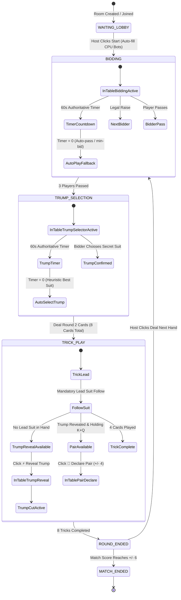

# Architectural & Mathematical Specification: Indian 29 (Twenty-Nine) LAN Multiplayer Card Game

## 1. Abstract & System Architecture
This document specifies the architecture, mathematical model, vector asset extraction pipeline, state machine, and real-time synchronization protocol for a production-grade LAN (Local Area Network) multiplayer implementation of the traditional South Asian trick-taking card game **29 (Twenty-Nine)**.

The system is architected around a server-authoritative Node.js (Express + Socket.IO) backend that binds to `0.0.0.0:3000`, auto-detects host private IPv4 network interfaces (e.g. `192.168.1.x`), serves pre-compiled production Vite client assets, and enforces 100% in-table gameplay without disruptive popups or modals.

```
+---------------------------------------------------------------------------------------------------+
|                                      Presentation Layer (React 18)                               |
|  [HomeView] <---> [LobbyView] <---> [GameTable] <---> [CardPreviewGallery] <---> [RulesDrawer]    |
|       - In-Table Bidding: Embedded felt dock with live raise/pass controls                       |
|       - In-Table Trump Selector: Secret suit chooser docked in table center                      |
|       - In-Table Trump Reveal: Action trigger illuminated upon non-lead suit                      |
|       - In-Table Pair/Royals: Crown declaration button on table felt                             |
|       - In-Table Round Summary: Inline deal results & score tracker                              |
|       - Non-blocking Rules Drawer: Accessible anytime without pausing match                       |
+---------------------------------------------------------------------------------------------------+
                                            |
                                            v (Socket.IO over LAN / Wi-Fi)
+---------------------------------------------------------------------------------------------------+
|                                State & Networking Controller Layer                                |
|   - LAN Client (lanClient.ts): Socket.IO client, automatic reconnect token handler               |
|   - LAN Host Server (server/index.ts): Express 5.3 + Socket.IO 4.8 binding to 0.0.0.0:3000        |
|   - IP Detector (server/lanUtils.ts): Automatic IPv4 discovery (192.168.x.x, 10.x.x.x)           |
|   - Room Manager (server/roomManager.ts): 4-seat matrix, room lock, 60s turn timer, CPU backfill   |
+---------------------------------------------------------------------------------------------------+
                                            |
                                            v
+---------------------------------------------------------------------------------------------------+
|                                  Core Deterministic Rules Engine                                  |
|   - types.ts: Algebraic state definitions, RoundSummary, GamePhase state machine                  |
|   - deck.ts: 32-card Fisher-Yates generator, two-phase dealing matrix (4 + 4 cards)               |
|   - bidding.ts: Range [16, 28/29], minimum raise validation, forced dealer bid                    |
|   - trump.ts: Concealed suit selector, request-to-reveal event handler, visibility control        |
|   - tricks.ts: Mandatory follow-suit validator, trump-cut logic, trick winner evaluator          |
|   - scoring.ts: Card points accumulator (28 + 1 bonus = 29), Royals Pair (+/- 4), Match (+/- 6)   |
|   - bot.ts: Heuristic AI agent for bidding, trump optimization, and trick play                    |
+---------------------------------------------------------------------------------------------------+
                                            |
                                            v
+---------------------------------------------------------------------------------------------------+
|                                Vector Artwork Extraction Pipeline                                 |
|   - Source EPS (OIUGSZ1.eps): 450x450 pt bounding box (1440 DPI, 9000x9000 px raster)            |
|   - Extraction Engine (scripts/extract_cards.py): Sub-pixel path isolation, corner flood-fill    |
|   - Dual Artifacts: 33 pure vector SVGs & 33 500x700 PNGs in public/assets/cards/                 |
|   - Manifest (cardManifest.ts): Normalized 32-card registry + geometric card back                 |
+---------------------------------------------------------------------------------------------------+
```

---

## 2. Mathematical Formalization of 29

### 2.1 Deck Composition & Point Topology
The playing space $\mathcal{D}$ consists of 32 cards formed by the Cartesian product of ranks $\mathcal{R}$ and suits $\mathcal{S}$:
$$\mathcal{S} = \{\text{Diamonds}, \text{Hearts}, \text{Clubs}, \text{Spades}\}, \quad |\mathcal{S}| = 4$$
$$\mathcal{R} = \{\text{Jack}, \text{Nine}, \text{Ace}, \text{Ten}, \text{King}, \text{Queen}, \text{Eight}, \text{Seven}\}, \quad |\mathcal{R}| = 8$$
$$\mathcal{D} = \mathcal{R} \times \mathcal{S}, \quad |\mathcal{D}| = 32$$

The point valuation function $\mathcal{V}: \mathcal{R} \to \{0, 1, 2, 3\}$ is defined as:
$$\mathcal{V}(r) = \begin{cases} 
3 & \text{if } r = \text{Jack} \\ 
2 & \text{if } r = \text{Nine} \\ 
1 & \text{if } r \in \{\text{Ace}, \text{Ten}\} \\ 
0 & \text{if } r \in \{\text{King}, \text{Queen}, \text{Eight}, \text{Seven}\} 
\end{cases}$$

The total card points in the deck $\mathcal{P}_{\text{cards}}$ is invariant:
$$\mathcal{P}_{\text{cards}} = \sum_{c \in \mathcal{D}} \mathcal{V}(c) = 4 \times (3 + 2 + 1 + 1 + 0 + 0 + 0 + 0) = 28\text{ points}$$

With the last-trick bonus $\beta_{\text{last}} = 1$ awarded to the winner of the 8th trick:
$$\mathcal{P}_{\text{total}} = \mathcal{P}_{\text{cards}} + \beta_{\text{last}} = 29\text{ points}$$

### 2.2 Seating & Partnership Graph
Players are indexed $p \in \{0, 1, 2, 3\}$ arranged clockwise around the table. The partnership function $\mathcal{T}: \{0, 1, 2, 3\} \to \{0, 1\}$ partitions players into two opposing teams:
$$\mathcal{T}(p) = p \pmod 2$$
- $\text{Team } 0 = \{0, 2\}$ (Seat 1: Bottom & Seat 3: Top partners)
- $\text{Team } 1 = \{1, 3\}$ (Seat 2: Left & Seat 4: Right partners)

Partners sit opposite each other: for player $p$, partner is $(p + 2) \bmod 4$.

---

## 3. Asset Extraction Matrix (EPS Source to Vector Manifest)

The source asset `poker-cards-icons-collection/OIUGSZ1.eps` contains a 6-row by 9-column matrix of 54 cards on an overall $450 \times 450$ point bounding box.

### 3.1 Spatial Grid Mapping for 29 Deck

| Rank | Diamonds | Spades | Hearts | Clubs | Points | Hierarchy Order |
| :--- | :---: | :---: | :---: | :---: | :---: | :---: |
| **Jack (J)** | $(c_0, r_2)$ | $(c_1, r_2)$ | $(c_2, r_2)$ | $(c_3, r_2)$ | 3 | 7 (Highest) |
| **Nine (9)** | $(c_0, r_4)$ | $(c_1, r_4)$ | $(c_2, r_4)$ | $(c_3, r_4)$ | 2 | 6 |
| **Ace (A)** | $(c_4, r_3)$ | $(c_4, r_2)$ | $(c_4, r_1)$ | $(c_4, r_0)$ | 1 | 5 |
| **Ten (10)** | $(c_0, r_3)$ | $(c_1, r_3)$ | $(c_2, r_3)$ | $(c_3, r_3)$ | 1 | 4 |
| **King (K)** | $(c_0, r_0)$ | $(c_1, r_0)$ | $(c_2, r_0)$ | $(c_3, r_0)$ | 0 | 3 |
| **Queen (Q)** | $(c_0, r_1)$ | $(c_1, r_1)$ | $(c_2, r_1)$ | $(c_3, r_1)$ | 0 | 2 |
| **Eight (8)** | $(c_0, r_5)$ | $(c_1, r_5)$ | $(c_2, r_5)$ | $(c_3, r_5)$ | 0 | 1 |
| **Seven (7)** | $(c_5, r_0)$ | $(c_6, r_0)$ | $(c_7, r_0)$ | $(c_8, r_0)$ | 0 | 0 (Lowest) |
| **Card Back** | — | — | — | $(c_4, r_5)$ | — | — |

*Grid Coordinates (in PostScript points):*
- Columns $c_0 \dots c_8$: $x \in [10.0, 49.5], [58.9, 98.7], [108.1, 147.8], [157.2, 197.0], [205.8, 244.5], [253.2, 292.0], [302.3, 341.6], [351.2, 390.6], [400.6, 439.9]$
- Rows $r_0 \dots r_5$: $y \in [54.4, 110.9], [120.4, 176.9], [186.4, 242.9], [252.3, 308.9], [318.3, 374.8], [384.3, 440.8]$

---

## 4. State Machine Transitions & In-Table Gameplay



---

## 5. LAN Multiplayer Networking Protocol

### 5.1 Client to Server Events
- `create_room`: `{ hostName, rules, preferredSeat }`
- `join_room`: `{ roomCode, playerName, preferredSeat }`
- `select_seat`: `{ roomCode, sessionToken, targetPosition }`
- `reconnect_seat`: `{ roomCode, sessionToken }`
- `start_match`: `{ roomCode, sessionToken }`
- `place_bid`: `{ roomCode, sessionToken, bid }`
- `select_trump`: `{ roomCode, sessionToken, suit }`
- `reveal_trump`: `{ roomCode, sessionToken }`
- `play_card`: `{ roomCode, sessionToken, cardId }`
- `declare_pair`: `{ roomCode, sessionToken }`
- `next_round`: `{ roomCode, sessionToken }`

### 5.2 Server to Client Broadcasts
- `room_update`: Sanitized seats, host ID, locked status.
- `game_state_update`: Full private hand for player, public table state.
- `timer_tick`: `{ remainingSeconds, turnPosition, phase }` emitted per second.
- `in_table_notification`: `{ type, message, cardId, timestamp }` for auto-play toasts and alerts.
